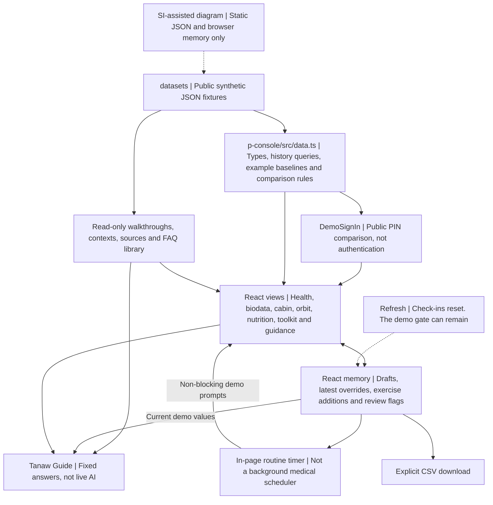

# System architecture — JSON demonstration

**SI-assisted documentation.** The TanawOrbit console is a browser application with static synthetic JSON fixtures and temporary memory state. Check-ins are not stored. There is no database.

`tanaworbit-api` is a separate read-only Cloudflare Worker. It republishes the same JSON files, including biodata, monitor parameters, cabin samples, orbital samples, and nutrition logs, and it rejects writes. `GET /api/verify` reruns the fixture checks. `GET /api/trends` returns the 14-day means. The astronaut console does not need the Worker to render. `/tester` calls it. The Worker is not a medical-record system, not authentication, and not a NASA telemetry feed.

The browser doors are `/a-login` for a fictional crew profile and `/b-login` for the public admin and tester codes. The demo gate remembers that public choice in `sessionStorage`. It does not store a measurement. Check-ins still reset on refresh.

## Implemented flow

Editable source: [diagrams/system-architecture.mmd](diagrams/system-architecture.mmd).

The PIN screen demonstrates profile selection only. All sample codes are public, compared in the browser, and explicitly labeled as not secure authentication. The previous display shield has been removed.

## Application boundaries

| File                            | Responsibility                                                                                                        |
| ------------------------------- | --------------------------------------------------------------------------------------------------------------------- |
| `p-console/src/App.tsx`                   | Crew console views, selected crew, latest-reading overrides, drafts, alerts, and export confirmation.                 |
| `p-console/src/DemoSignIn.tsx`            | Preloaded crew selection, keypad/keyboard input, public-PIN comparison, and auto-continue.                            |
| `p-console/src/data.ts`                   | JSON imports, types, history selection, per-crew synthetic baseline means, and comparison rules.                      |
| `p-console/src/ExercisePanel.tsx`         | Exercise input/review, activity history, temporary session additions, and recovery context.                           |
| `p-console/src/useConsoleDisplay.ts`      | Auto/desktop/touch layout and browser fullscreen behavior. No privacy or inactivity shield remains.                   |
| `p-console/src/index.css`, `p-console/src/demo.css` | Main console, responsive touch layout, demo entry, and exercise styles.                                               |
| `datasets/`                     | Public synthetic profiles, mission, 150 health records, comparison rules, activity catalog, and 25 exercise sessions. |
| `tanaworbit-api/src/index.ts`   | Read-only GET routes for those same files. Write methods return 405. `/tester` calls this Worker for fixture and baseline math verification. |
| `scripts/verify-datasets.mjs`   | Read-only fixture integrity checks, run with `pnpm test:data`.                                                        |

## Health and exercise state

The initial latest readings come from JSON. A confirmed check-in replaces the latest reading in React memory and the current-day trend point. The prior 30-day fixture history remains unchanged. Baselines are arithmetic means of each crew member's previous 14 synthetic mission days, excluding the current day; they are not learned medical norms.

Exercise fixtures are copied into memory. Confirming a session adds a temporary entry and updates activity totals, bars, and the log. Recovery context reads the current in-memory sleep/fatigue values. No exercise prescription or diagnosis is generated.

Drafts and temporary changes survive navigation while the page remains mounted. Refresh clears check-ins and reloads the original fixtures. The public demo choice can remain in `sessionStorage` until sign-out. No interaction writes to the JSON files.

## Documentation

- [Data architecture and conceptual entity relationships](data-architecture.md)
- [Application logic and comparison rules](logic.md)
- [Tablet and demo-access guide](console-guide.md)
- [Dataset contract and public demo PINs](../datasets/README.md)
- [Check-in sequence](diagrams/check-in-flow.mmd)

## Trust and scientific limits

- The frontend demo gate can be bypassed. It does not authenticate users or protect records.
- The gate stores the chosen public profile or role in `sessionStorage`. It does not store a measurement.
- There are no real credentials, private medical records, secure sessions, localStorage health records, database, or cross-device synchronization.
- `tanaworbit-api` republishes the same synthetic JSON and rejects writes. It is not a medical-record API.
- Fixture dates and mission details are fictional. Display notices must remain visible.
- Earlier health points are synthetic JSON records; waveform drawings and decorative sparklines remain illustrative.
- Observe rules are unvalidated comparison differences. Stable does not establish health, and Attention is a scripted review-request flag.
- Physiological displays do not reproduce a validated PUMA sensor model or connect to NASA devices.
- No clinical, hardware, usability-in-space, or security validation has been established.

A production implementation would need a separate backend/authentication design, protected credential handling, appropriate data controls, and expert review. The conceptual relational diagram is not a deployed database.

## Educational toolkit and helper

`p-console/src/HealthToolkit.tsx` provides measurement-recording walkthroughs, a current-run routine checklist, a non-diagnostic body schematic, mission-context explanations, and evidence/source labels. `p-console/src/toolkitData.ts` imports read-only knowledge JSON and formats fixed educational explanations. `p-console/src/NextSteps.tsx` connects the dashboard to those sections.

`p-console/src/useRoutineReminders.ts` schedules optional in-page prompts in memory. It does not schedule background notifications or medical tasks. `p-console/src/TanawGuide.tsx` uses fixed FAQ answers and limited keyword selection; it does not call an AI provider. The guide's dialog temporarily makes the page inert for accessibility, not privacy or authentication. `p-console/src/FeatureBoundary.tsx` contains loading failures for the separately loaded toolkit/guide chunks.

Mission-context previews alter explanatory content and highlighted hazards only. They do not change source measurements, baseline means, or comparison rules. The body view is not a scan, and none of these features diagnose or prescribe. See [toolkit-and-guide.md](toolkit-and-guide.md) and [measurement-guides.md](measurement-guides.md).
