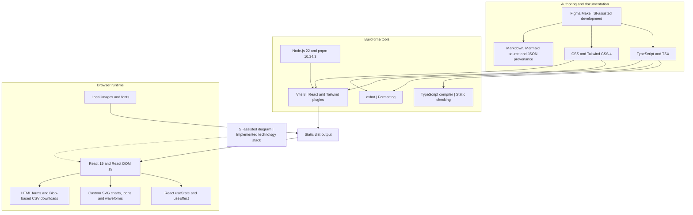

# Technology stack

**SI-assisted documentation.** Versions below distinguish package declarations from the lockfile snapshot; installed versions may change if dependencies are updated.

## Stack diagram



Editable source: [diagrams/tech-stack.mmd](diagrams/tech-stack.mmd).

## Application and build dependencies

| Technology             | Declared version          | Lockfile version            | How it is used                                                              |
| ---------------------- | ------------------------- | --------------------------- | --------------------------------------------------------------------------- |
| React                  | `^19.0.0`                 | `19.2.4`                    | UI components, state, effects, and conditional views.                       |
| React DOM              | `^19.0.0`                 | `19.2.4`                    | Mounts and renders the application in the browser.                          |
| React Router DOM       | `^7.18.5`                 | `7.18.5`                    | Client-side routing between `/`, `/a-login`, `/b-login`, `/admin`, `/tester`, and `/Astronaut`. |
| Recharts               | `3.8.0`                   | `3.8.0`                     | Composite charting components for specialized trends.                        |
| Lucide React           | `^0.577.0`                | `0.577.0`                   | Comprehensive vector iconography suite.                                      |
| TypeScript             | `^5.7.0`                  | `5.9.3`                     | Type-checks TS/TSX. A compiler version is not a browser runtime dependency. |
| Vite                   | `^8.0.5`                  | `8.0.5`                     | Development/build tooling and static asset bundling.                        |
| Tailwind CSS           | `^4.0.0`                  | `4.2.2`                     | Utility styling with additional custom CSS.                                 |
| `@tailwindcss/vite`    | `^4.0.0`                  | `4.2.2`                     | Tailwind integration in the Vite build.                                     |
| `@vitejs/plugin-react` | `^6.0.0`                  | `6.0.1`                     | React transform and development hot-refresh integration.                    |
| oxfmt                  | `^0.76.0`                 | `0.76.0`                    | Repository formatting tool.                                                 |
| Node.js                | `22` in `.mise.toml`      | Not pinned to a patch there | Build/development runtime, not an application backend.                      |
| pnpm                   | `11.20.0` in the root `package.json` | Lockfile from that pnpm release | Workspace scripts for `p-console` and `tanaworbit-api`.            |

React and Node type-definition packages are development dependencies. `pnpm-lock.yaml` contains the complete transitive dependency inventory.

## Browser-native functionality

- **State and navigation:** `react-router-dom` (v7) handles screen routing (`/`, `/a-login`, `/b-login`, `/admin`, `/tester`, `/Astronaut`), paired with React `useState` for in-memory view switching and interactive modalities across 16 console views.
- **Effects and accessibility:** `useEffect`, DOM focus handling, Escape dismissal, focus-visible styles, and reduced-motion CSS.
- **Charts:** Handwritten SVG polylines, sparklines, circles, gradients, and hover targets combined with `recharts` for specialized telemetry visualisations.
- **Forms:** Native number inputs, required/min/max/step constraints, buttons for fatigue and mood, and an optional notes field. Browser input constraints do not equal clinical validation.
- **Downloads:** `Blob`, `URL.createObjectURL`, an anchor download, and `URL.revokeObjectURL` produce a local CSV.
- **Touch console and demo entry:** `matchMedia`, responsive CSS, browser Fullscreen API, and an astronaut demo-entry screen with designated public PINs and crew photos. No real authentication or persistent storage is implemented.
- **Data:** Static JSON imports through `p-console/src/data.ts`, with 150 health records across 5 crew members, plus React-memory latest-reading overrides and temporary exercise additions. Run `pnpm test:data` to validate fixtures.
- **Assets:** Local JPEG crew photographs and mission imagery; SVG/PNG TanawOrbit branding; WOFF2 DM Sans and IBM Plex Mono fonts.
- **Guidance & walkthroughs:** Stored educational notes, interactive anatomical adaptation reference, and 12 curated Tanaw Guide answers. No NASA API calls or medical-content service is used.

## Design and documentation tools

- **Figma Make SI coding assistant:** Assistance with interface design, code, synthetic examples, graphics, and these documents.
- **Mermaid / Mermaid Live:** Editable documentation diagrams. Mermaid is not installed in the app or called at runtime.
- **Markdown and JSON:** Human-readable submission documentation and machine-readable provenance.

The source logo was authored as vector code with SI assistance. Existing PNG copies are raster exports, not generated photographs.

## Commands prescribed by this repository

Run from the repository root:

```sh
# Application type check
pnpm exec tsc --noEmit

# Production build
pnpm build

# Format only the documentation added for this task
pnpm format docs

# Check documentation formatting
pnpm exec oxfmt --check docs
```

`pnpm dev` starts the console on port 5173. `pnpm dev:api` starts the read-only Worker on port 8787. `pnpm build` writes the console to `p-console/dist`. A successful build does not publish the project or create the public link required by the submission form. `pnpm test:data` runs the fixture-integrity checks. It does not establish clinical validity or replace browser interaction testing.

## Read-only Worker

`tanaworbit-api` is a Cloudflare Worker using Hono. It imports `datasets/*.json` and answers GET requests only. It has no database binding, no secret, and no route that stores a check-in. The console still bundles the fixtures itself.

## Explicitly not in the current stack

No Next.js, Payload CMS, Supabase, Firebase, SQL/NoSQL database, authentication provider, persistent medical records, wearable hardware, NASA telemetry adapter, LLM API, or machine-learning service is implemented. The Worker is not any of those systems.

## Educational feature modules

- React `lazy`/`Suspense` load the Health Toolkit and Tanaw Guide separately; an error boundary allows returning to the console if a feature cannot load. This is not an offline-first or validated medical deployment.
- `useRoutineReminders` uses frontend timeouts only, with no background worker, push service, or persistent scheduler.
- `toolkitData.ts` imports static walkthrough/context/source/FAQ JSON. There is no vector database, RAG service, language model, chat API, or runtime SI.
- The body overview is original SVG/HTML, not a scan or sensor integration.
- `pnpm test:data` includes read-only knowledge-fixture consistency checks.
